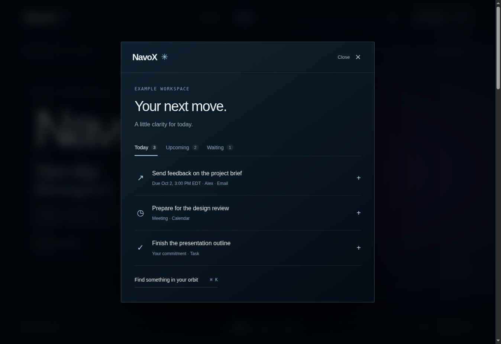
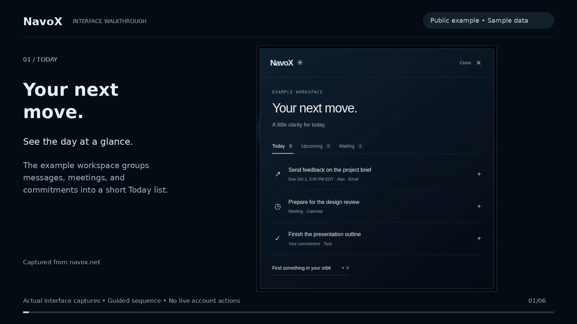
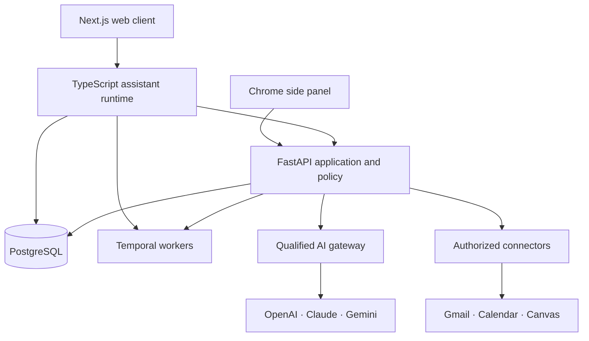

# NavoX

**A personal AI assistant for your inbox, calendar, classes, and subscriptions.**

[Open NavoX](https://navox.net) · [Architecture](#architecture) · [Run locally](#run-locally) · [Development](#development)

NavoX brings scattered work into one daily view. See what needs attention, ask a
question about connected information, prepare for a meeting, or draft a reply.
Conversations keep their history, answers link back to sources, and external
actions have a separate review and approval step.

## See it in action



[](docs/media/navox-walkthrough.mp4)

**[Watch the walkthrough](docs/media/navox-walkthrough.mp4)**

The screenshot and walkthrough show the public example workspace with sample
data: Today, Upcoming, Waiting, source details, and task search.

## What it does

| Area | What you can do |
| --- | --- |
| Daily priorities | Review commitments, meetings, and follow-ups; adjust attention preferences and quiet hours. |
| Connected accounts | Connect Gmail, Google Calendar, and institution-configured Canvas accounts with explicit permissions. |
| Conversations and search | Resume saved chats, ask about connected sources, and handle requests with multiple intents. |
| Reply watches | Choose a reminder after a verified email send; check the Gmail thread for a reply and manage watches in Inbox. |
| Personal routines | Preview a morning priorities, Friday catch-up, or no-reply review, then schedule it in Planner. Results use saved data. |
| Saved preferences | Edit or forget your reply style and reusable details in Settings; choose which to add visibly to a message. |
| Voice | Record a question, hear a response, and choose text or voice delivery. |
| Subscriptions | Track recurring costs, renewals, trials, and price changes, grouped by currency. |
| News | Read source-linked stories, save items, and ask follow-up questions. |
| Chrome side panel | Check priorities, review proposed actions, and capture page notes from the browser. |

Connected features require their own OAuth configuration and permissions. AI and
speech features require configured provider routes; hands-free recognition also
depends on browser support. The [public news catalog](config/news/README.md)
includes USGS, NASA, NOAA, and BEA feeds with source-specific content permissions.

## For students

The next product focus is a personal assistant for students at any college:
know which class is now or next, keep a confirmed timetable, and build a day
around classes, shifts, and deadlines. This work is in progress. The first
release focuses on timetable setup, reliable class answers and class alerts.
Plan Update 1 makes **Vox**, a one-tap hands-free call, the primary voice target;
the chat-box mic remains for single questions. Personal calendars, free-time
scheduling and disclosed text-based memory join the build priorities. Adaptive
planning, course workspaces, recovery and coaching follow measured student gates.

The [student roadmap](docs/product/student-roadmap.md) is the canonical build
specification for the full product plan, **Plan Update 1, the Whiteboard Tutor guide and Whiteboard Update 1 — Builder Spec**.
The updates win within their respective scope. The roadmap maps requirements to acceptance criteria and
distinguishes implementation, automated verification and real-student validation;
Vox, personal-calendar scheduling and conversation-derived memory remain planned.

Vox ownership is prepared behind `NEXT_PUBLIC_NAVOX_STUDENT_VOX_ENABLED=false`.
An opt-in build mounts one owner above page routes, suspends its audio authority
during account checks, and ends old calls before sign-in changes or student-data
reset. An opt-in build includes a call dialog and minimized dock with separate
microphone/speaker controls. A gated LiveKit adapter and local processed VAD
capture have synthetic coverage; their default admission and capture remain
unavailable. Server media authority, the voice worker and supported-device
qualification still need integration. The
[delivery plan](docs/product/delivery-plan.md) records that work and its gates.
The server also has content-free call reservations behind
`STUDENT_VOX_ENABLED=false`, tied to the exact browser login with short renewable
leases and reset/logout replay fences. These reservations explicitly disable
media. See the [server contract](docs/product/vox-session-contract.md).

NavoX Board includes five authored practice lessons with step playback, quick
checks, progressively drawn sketches, traced handwriting-shaped letter contours
and equation reveals, pan/zoom and pen notes. Pause freezes the current reveal;
reduced motion keeps the cue pacing and shows each element immediately. Set
`NEXT_PUBLIC_NAVOX_STUDENT_WHITEBOARD_ENABLED=true` before building the web app
to expose `/board` after sign-in; `/whiteboard` redirects to it.

Explicit encrypted saves additionally require `STUDENT_BOARD_ENABLED=true`, the
configured connector encryption key, and migration `0047_saved_boards`. Students
can name a Board, optionally attach it to their own course, and return to saved
answers, revisit markers and drawings with playback paused. Save updates use
revisions; erasure and student-data reset invalidate old requests. Both flags
default off while release and real-phone qualification remain open. Unsaved
changes remain temporary, and an unfinished lesson reveal starts again on
reopening. Writing uses a pinned, locally compiled OFL font subset, with accessible
SVG text for unsupported scripts; these letter contours do not reproduce a
person's pen-stroke order. AI lesson generation, Vox voice sync and question
uploads are later roadmap stages.

## Design decisions

- **Keep the source attached.** Commitments and answers retain source references
  so a user can inspect the context behind a priority or response.
- **Review the exact action.** Email approval covers the recipient, subject, and
  body. Editing the draft invalidates that approval. The worker checks the saved
  version and payload hash before sending; an ambiguous send result goes to
  manual review instead of an automatic retry.
- **Separate conversation from authority.** The TypeScript runtime coordinates
  sessions and plans. The Python API checks connector permissions and external
  actions. Workspace ownership is checked at retrieval and execution boundaries.
- **Make background work durable.** Temporal handles source processing, timers,
  and bounded workflows. PostgreSQL stores operational state, approval versions,
  and audit events so work can resume across process restarts.

## Architecture



The AI gateway has adapters for OpenAI, Anthropic Claude, and Google Gemini.
Model selection, task qualification, sensitivity permissions, cost limits, and
circuit breakers are enforced before a provider request. Configuring an adapter
does not enable its models or fallback routes automatically.

Read the [assistant runtime](docs/architecture/assistant-runtime.md) and
[connected retrieval](docs/architecture/connected-retrieval.md) guides for the
request lifecycle, ownership checks, failure handling, and implementation bounds.
The [documentation index](docs/README.md) connects these guides to the rest of
the system.

| Path | Responsibility |
| --- | --- |
| `apps/web` | Next.js interface and authenticated assistant routes |
| `apps/extension` | Manifest V3 side panel and explicit capture |
| `packages/assistant-runtime` | Session orchestration, voice contracts, and bounded goal workflows |
| `packages/contracts` | Shared TypeScript API contracts |
| `services/api/navox` | FastAPI services, connectors, retrieval, gateway, and policy |
| `services/api/migrations` | Python-owned PostgreSQL migrations |
| `evals` | Synthetic evaluation cases and reference baselines |
| `docs/adr` | Architecture decision records |
| `docs/architecture` | Detailed system design and operational procedures |

## Run locally

Install Git and Docker Engine or Docker Desktop with Compose v2. The containers
use Python 3.12, Node 24, PostgreSQL 17, and Temporal.

```bash
git clone https://github.com/michaelbawuah/NavoX.git
cd NavoX
cp .env.example .env
docker compose up --build
```

Open [the web app](http://localhost:3000), [API documentation](http://localhost:8000/docs),
or [Temporal UI](http://localhost:8080). Register a local account to explore the shell.
The stack applies the Python and TypeScript migrations before the web service starts.
First startup can take several minutes while dependencies and images build.

The example environment starts with AI disabled and empty OAuth credentials.
To use connected features, configure your own credentials in `.env`, then follow
the [gateway setup](docs/architecture/spec-005-gateway.md) and
[connector setup](docs/architecture/spec-002-operations.md) guides.
Google sign-in and Gmail read/send permissions are separate grants.

Keep `.env` and provider credentials outside version control. The
[deployment guide](deploy/README.md) covers HTTPS, secret configuration, and the
production Compose overlay.

### Chrome extension

```bash
npm ci
npm run build --workspace=@navox/extension
```

In `chrome://extensions`, enable Developer mode, select **Load unpacked**, and choose
`apps/extension/dist`. The local build uses the local API and web app. Deployment
origins and the permission boundary are documented in the
[extension guide](docs/architecture/milestone-8-chrome-extension.md).

## Development

For development outside the containers, use Node 24, npm 11, Python 3.12, and
[`uv`](https://docs.astral.sh/uv/). The [local development guide](docs/reference-guide.md)
covers environment loading, migrations, and separate application processes.
Run the repository checks with:

```bash
npm ci
npm run lint
npm run typecheck
npm run test
npm run build
bash scripts/check-api.sh
```

The full suite requires disposable PostgreSQL and Temporal services. The
[API quality guide](docs/development/api-quality.md) describes the test environment.

The [CI workflow](.github/workflows/ci.yml) runs web, API, extension, dependency
security, evaluation, and Compose integration checks. Evaluation fixtures are
synthetic; provider qualification uses a separate process.

Further reading: [storage](docs/adr/ADR-001-postgresql-operational-system-of-record.md),
[durable workflows](docs/adr/ADR-002-temporal-durable-workflows.md),
[action approval](docs/adr/ADR-006-human-approval-consequential-actions.md), and
[workspace isolation](docs/adr/ADR-007-workspace-tenant-isolation.md).

## License

No open-source license has been granted. The source is available for inspection;
all rights are reserved by the owner.
