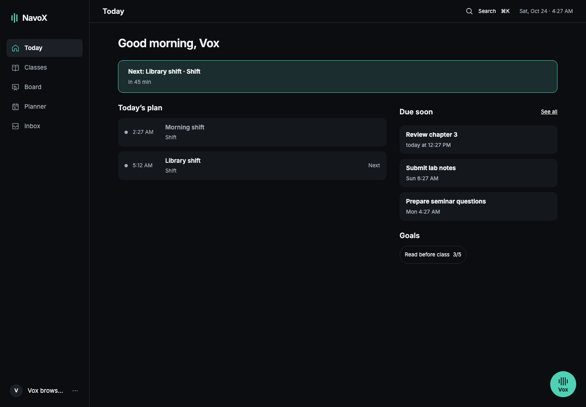
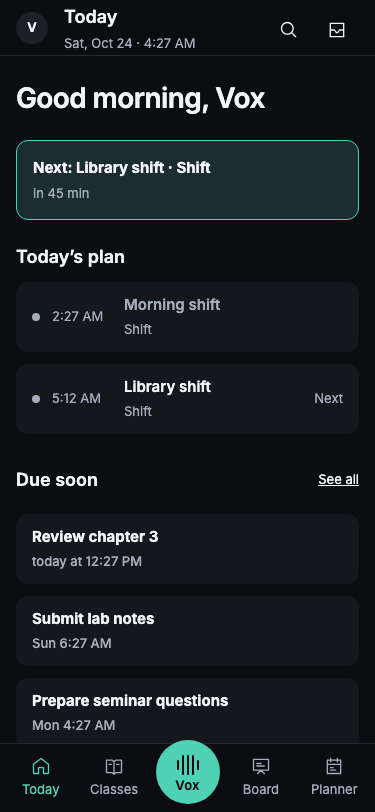
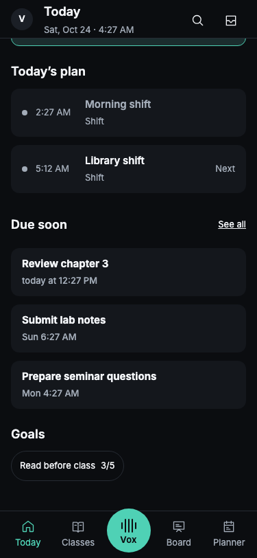
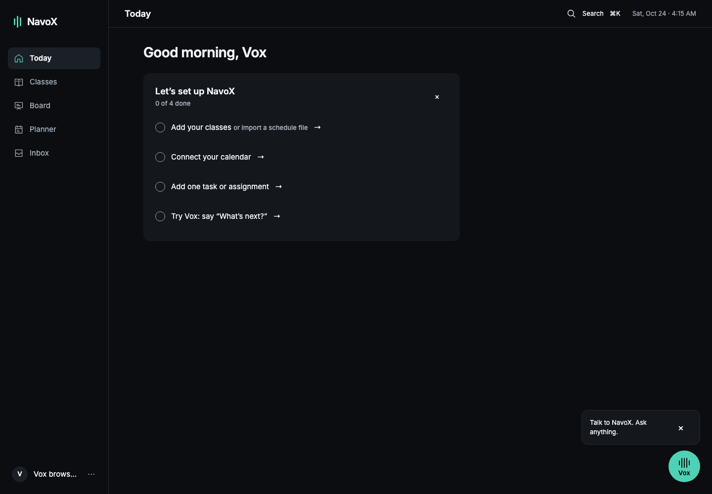
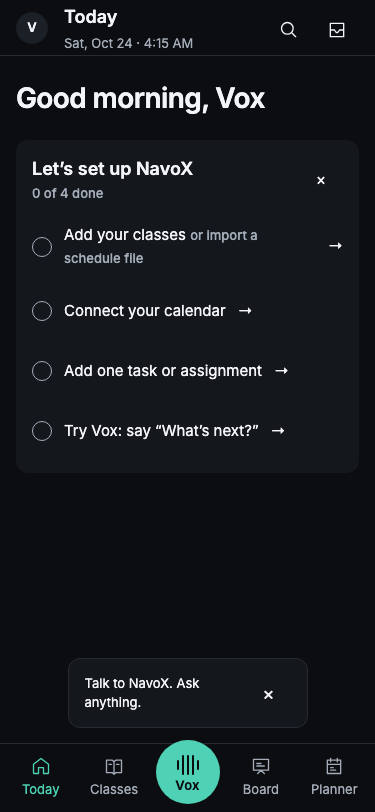
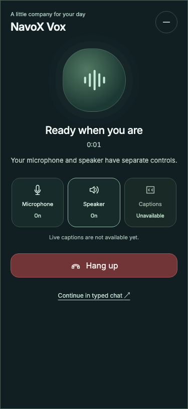

# M2 shell and Today: first preview

Preview: https://vox-test.66-175-235-169.nip.io/

Application release: \`79cf83c\`. This is a first slice, not full milestone acceptance.
All screenshots use the isolated synthetic QA account. The populated screens use
records saved through the real APIs, not intercepted or hard-coded responses.

## Checks completed

- [x] 2,498 web tests; web and UI TypeScript checks; web lint.
- [x] Production web build and isolated test deployment.
- [x] Desktop sidebar, profile menu, local date/time and Cmd/Ctrl+K search.
- [x] 375 px Chromium touch emulation: tabs, profile menu, scrolling, Planner tap;
      no horizontal overflow. After scrolling, the goal chip sits above the tab bar,
      can be tapped, and opens Goals; the header/profile remain aligned.
      Physical-phone verification is not included.
- [x] Persistent Vox through Today → Classes → Planner → Today, mobile minimize,
      navigation and reopen: exactly one call admission.
- [x] Desktop call panel 400 px and modeless; mobile panel 375 px and modal.
      Resizing an open call keeps the call intact.
- [x] Hang-up: both cleanup responses 204, capture track ended, peer closed.
- [x] Real saved shifts appear in chronological order; past shift muted;
      next shift and countdown visible.
- [x] Three saved tasks due within 72 hours appear; a fourth due in five days does not.
- [x] Goal chip reflects the actual saved check-in: 3/5.
- [x] Setup counts saved task state, dismissal survives reload, and Planner links work.
- [x] Representative text/background contrast pairs: dark primary 16.3:1,
      dark muted 7.2:1, light primary 18.47:1, light muted 5.45:1,
      dark accent button 10.3:1, light accent button 5.56:1.
      This is not a complete all-screen accessibility audit.
- [x] Final voice check: zero active calls, checkpoints, unfinished media cleanup,
      LiveKit rooms and participants.
- [x] Removed the seven created QA records; zero QA shifts, tasks and goals remain.
- [ ] Physical-phone acceptance and recording: waiting on Michael.
- [ ] Complete M2 acceptance: remaining items below.

The test harness initially checked the resize state before the browser media-query
event ran; waiting for the actual state passed. The live saved-data check also
found that the M1 preview configuration disabled planning/goals. The preview now
pairs their frontend and backend flags. These are verification findings, not
waived acceptance tests.

## Screenshots

Desktop, saved QA data:

Mobile touch emulation, top of Today:

Mobile touch emulation, scrolled to goals:

New-student setup:

Existing Vox call visual in the new full-screen placement:

## Remaining acceptance and explicit differences

- [ ] Combined transcript and typed-input panel, its four suggestions, settings
      controls and message-limit audit. Typed chat remains reachable from the call.
- [ ] Real connected-email reply badge across every screen; Today projection is
      implemented but no connected personal mailbox was used for this evidence.
- [ ] Inline Today study outcomes. Current links open the existing Planner review
      form; Skip still requires confirmation there.
- [ ] Saved Board resume link live check. Board remains behind its existing release
      flag; Part 3 is not being marked complete.
- [ ] All four onboarding steps completing together against real integrations.
- [ ] Full source screenshot comparison, consistent course
      colors across later screens, light-theme interaction and reduced-motion audit.

The header uses a compact 18 px page label while the Today greeting uses 28 px.
Profile pictures currently fall back to initials. Phone controls reserve at least
44 px targets; the central Vox control is 64 px and the bottom bar reserves its
own slot. These differences remain reviewable and are not treated as an exact
match to every supplied screen. Existing Classes/Planner/Inbox content keeps its
working behavior pending the later redesign milestone. Noa's artwork and states
remain Part 2; the current Vox visual is preserved.

GitHub Actions returned no pull-request workflow runs for this stacked draft head;
local checks and live preview evidence above are the available validation.
