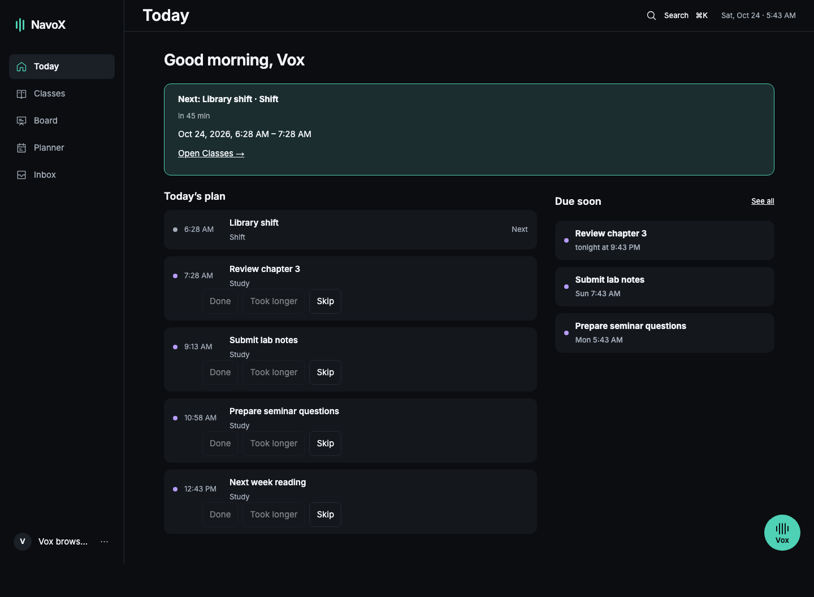
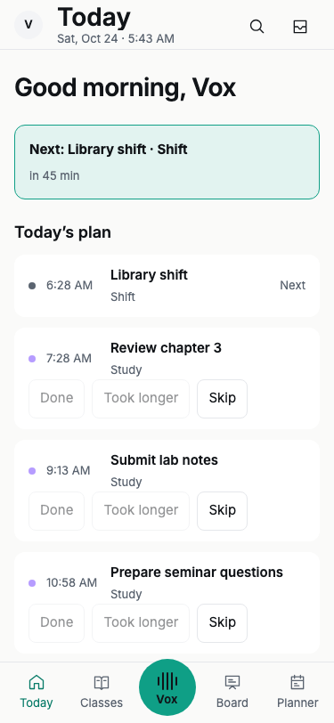
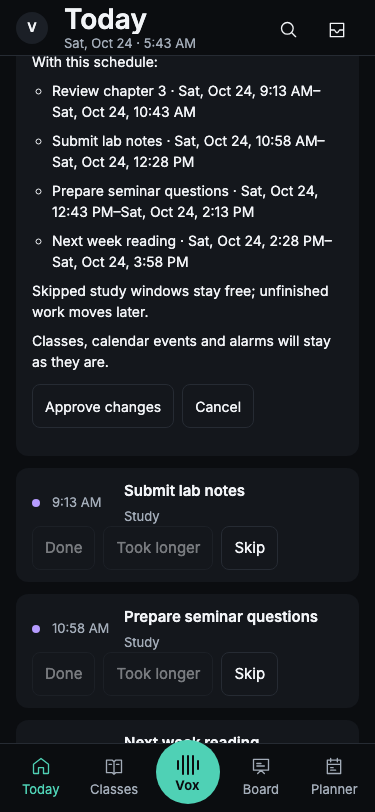
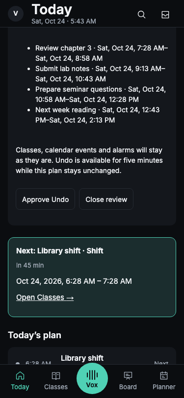
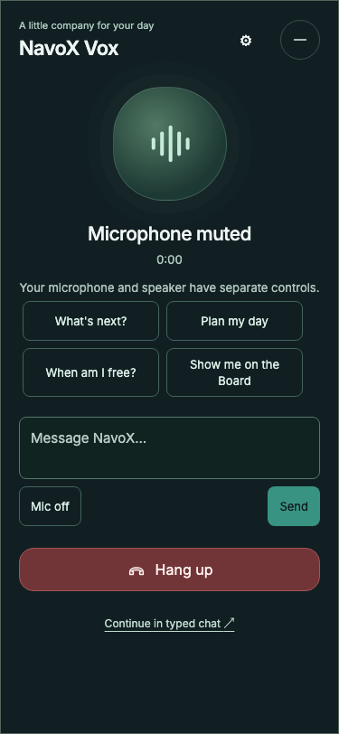
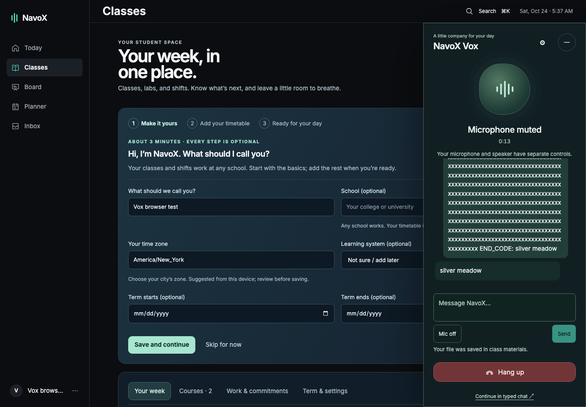

# M2 shell, Today and Vox conversation

Test link: https://vox-test.66-175-235-169.nip.io/

Application release: `c0bc9c1`. The implementation is on the isolated test site;
main and production are unchanged. Physical-phone and visual sign-off are pending.
Screenshots contain only synthetic QA data saved through the real APIs.

## Acceptance evidence

- [x] Desktop 220 px sidebar, 56 px header, 28 px title, profile menu,
  search/Cmd+K and student-local date/time. Mobile tabs and 64 px Vox control.
- [x] 375 px touch emulation: no horizontal overflow; header/profile stay aligned,
  scrolling keeps content reachable above the tab bar; controls have 44 px targets.
- [x] Desktop Vox is a persistent 400 px modeless panel; phone emulation is full
  screen. Route changes, minimize/reopen and resize preserve the same call.
- [x] Transcript and typed input use the real running voice provider and call
  context. Muted typing, context after Today → Classes, and one call admission
  passed against the live deployment.
- [x] An 8,000-character message reached the real model intact: it correctly
  returned the sentinel at the end. Voice input remains limited to 4,000.
- [x] All four specified suggestions, bottom composer/mic, over-7,000 counter,
  auto-growing textarea, header settings and speaker control.
- [x] An 8,710-character paste was preserved and saved through the private class
  material upload. The downloaded original matched every character, including
  trailing whitespace. Extracted document text is normalized by the existing
  pipeline. The student explicitly chooses the class; files persist after hang-up.
- [x] Hang-up stops browser capture and clears visible text immediately. After
  the server’s end response, the transcript endpoint returns 410. A fresh sign-in
  for the same student cannot read or write the earlier session’s call.
- [x] Real Today data: chronological plan, current/past states, next event details,
  known travel time only, three near-term due items, real goal progress, hidden
  empty sections and genuine-state onboarding/dismissal.
- [x] Done / Took longer / Skip work inline. Real API testing confirmed that the
  preview leaves the saved plan unchanged, then approval applies the shown plan.
  Unit/API tests cover all three outcomes and reject stale/forged previews.
- [x] Live Undo on `c0bc9c1`: opening the inverse readback did not write; explicit
  approval restored every original block status. Automated tests also cover
  retrying the same Undo request without duplicate changes.
- [x] Cross-screen Gmail-action badge uses the same source projection and saved
  timezone; disconnected sources and late previous-account responses are excluded.
  No personal mailbox contents were used for these screenshots.
- [x] Dark/light selection persists across navigation and reload. Evening due
  times use “tonight”. Date/DST projection tests remain passing.
- [x] Web suite: **2,511 passed**. TypeScript and Biome checks pass.
- [x] Broad voice API suite: **543 passed, 91 skipped**; final panel/queue checks:
  **18 passed, 1 skipped**. Planning suite: **47 passed, 2 skipped**.
  Skipped PostgreSQL-specific or optional provider checks are not claimed passed.
- [x] Coursework: 54 passed, 1 skipped; one Mac check could not find the Linux
  PDF executable. The corresponding invalid-PDF rejection was verified on the
  actual Linux test server (422); text saving was verified end to end.
- [x] Production web build and isolated test deployment succeeded.
- [x] Final cleanup: zero active calls, retained checkpoints, unfinished media
  cleanup jobs, LiveKit rooms or participants. Created tasks/shifts/materials and
  the 12 synthetic QA course fixtures were removed. Usage/audit records remain.
- [x] The latest real QA call logged 3,662 tokens, 5.450 seconds speaking and
  7.035 seconds idle, with $0.0182184 estimated provider cost. A separate zero-token
  provider stream remains explicitly uncertain; estimates are not final invoices
  and no quota/audit records were erased to hide uncertainty.
- [ ] Physical-phone browser test and recording: waiting on Michael.
- [ ] Final visual acceptance against the supplied references: waiting on Michael.
- [ ] Real-student usability/usage targets: waiting on real usage.

## Screenshots

Desktop Today with real saved QA data:

Light mode on a 375 px emulated phone:

Study progress: every replacement is listed before approval:

Undo lists the inverse changes before approval:

Full-screen Vox with suggestions, composer, mute and hang-up:

Live typed conversation in the desktop panel:

Earlier slice evidence remains available in `desktop.png`, `mobile.png`,
`desktop-populated.png`, `mobile-populated.png` and `mobile-goals.png` for the
four-step setup, past-event styling and a saved 3/5 goal check-in.

## Differences and remaining staged integrations

- Light active navigation text uses #087B68 (4.97:1 against #FAFAF9) rather than
  #0F9F86 (3.18:1). The specified accent fill stays #0F9F86. Representative other
  pairs: dark muted 7.20:1, light muted 5.45:1, light accent-button text 5.56:1.
- Controls reserve at least 44 px touch areas; header title is now the specified
  28 px. The phone header reserves its second line for date/time.
- Accounts without a profile photo use initials. No photo-upload UI was added.
- Existing Vox artwork/palette is preserved. Exact Noa art, animation and rewards
  remain Part 2. Board’s live saved-lesson check remains with its enabled release
  in Part 3; its current release flag is respected.
- Calendar-connected completion of all four setup steps remains an M3 integration
  check. Live mailbox acceptance belongs to Connections/Inbox testing. Nothing
  disconnected is presented as connected or completed.
- Existing Classes/Planner/Inbox/Connections/Settings content and legacy standalone
  chat remain available while their later redesign/migration is pending. Their
  old typography/course colors/message limits are not claimed as redesigned here.
- Picovoice approval is still a separate M1 gate; this preview does not mark wake
  word or locked-phone/background operation as passed.

## Phone acceptance checklist for Michael

Use the existing private test login. These boxes are deliberately not pre-ticked.

- [ ] Today: inspect the greeting, next-event details, timeline, due items and setup.
- [ ] Navigate with the bottom tabs, profile menu and search; scroll long content.
- [ ] Vox: talk, interrupt, mute, type, minimize, switch pages and return. Confirm
  the same conversation remains; hang up and check that microphone use stops.
- [ ] Paste a long question: verify the counter and that text is not cut off.
  Save over-limit text to a class only if you want it retained as a file.
- [ ] On a real study block, preview Done/Took longer/Skip. Read all listed changes,
  approve, then review Undo and approve the restoration. Confirm the result.
- [ ] Switch light/dark in Settings; reload and confirm the choice remains.
- [ ] Record the phone test and report any difference from the design references.

This is Chromium mobile emulation evidence, not a physical-phone recording or a
claim that real-student usage targets have passed.
